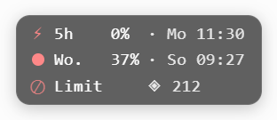
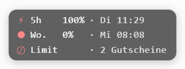

# xCodex Costs

[Deutsch](#deutsch) · [Русский](#русский) · [English](#english)

Userscript für **Tampermonkey**: 5-Stunden-Limit und wöchentliches Limit des ChatGPT-Kontos
als schwebendes Badge auf **chatgpt.com** — plus Tagesbudget für heute.



---

## Deutsch

Drei Zeilen, ein Raster: Symbol | Label | Wert | Reset-Zeitpunkt.

| Zeile | Symbol | Bedeutung |
|---|---|---|
| 1 | ⚡ | 5-Stunden-Limit: Rest in % · Zeitpunkt der Rücksetzung |
| 2 | ● | Wöchentliches Limit: Rest in % · Zeitpunkt der Rücksetzung |
| 3 | Ø | wie viel des Wochenkontingents **heute noch** drin ist |

Ist das Limit erreicht, bleiben die Zahlen stehen und Zeile 3 zeigt den Status:



- **`Ø`** = Tagesrate aus `übrig ÷ Resttage`, davon nur die Restzeit bis Mitternacht
  (bzw. bis zum Reset, falls der früher liegt). Sinkt mit dem Verbrauch, steigt, wenn der
  Reset näher rückt.
- Farbe der Symbole nach dem **5-Stunden-Limit**: **grün ab 20 %**, **gelb 5–19 %**, **rot unter 5 %**.
- **Limit erreicht:** `⊘ Limit · N Gutscheine` — man sieht, welches Fenster leer ist und ob
  Reset-Gutscheine bereitliegen.
- Bedienung: **Klick** öffnet die Nutzungsseite in einem neuen Tab, **Ziehen** verschiebt das
  Badge, **Tooltip** zeigt Verbrauch, Restzeit, Plan, Credits und Gutschein-Ablauf.
- Aktualisierung: jede Minute, zusätzlich beim Tab-Fokus; ohne frischen Wert ⏳ nach 30 Minuten.

**Installation**

1. Tampermonkey im Browser.
2. [Greasy Fork](https://greasyfork.org/de/scripts/603426-xcodex-costs) → „Installieren"
   — oder `xcodex-costs.user.js` importieren (Hilfsmittel → „Aus Datei importieren").
3. `chatgpt.com` öffnen.

**Wichtig:** Steht `chatgpt.com` in Tampermonkeys Negativliste (Einstellungen → Sicherheit),
startet dort **kein** Userscript und das Badge bleibt unsichtbar.

---

## Русский

Три строки, один растр: символ | метка | значение | время сброса.

| Строка | Символ | Значение |
|---|---|---|
| 1 | ⚡ | 5-часовой лимит: остаток в % · время сброса |
| 2 | ● | Недельный лимит: остаток в % · время сброса |
| 3 | Ø | сколько процентов недельного лимита доступно **сегодня** |

Если лимит исчерпан, числа остаются, а третья строка показывает статус:


- **`Ø`** — дневная норма из `остаток ÷ дни до сброса`, из неё только время до полуночи
  (или до сброса, если он раньше). Падает с расходом, растёт при приближении сброса.
- Цвет символов по **5-часовому лимиту**: **зелёный от 20 %**, **жёлтый 5–19 %**, **красный менее 5 %**.
- **Лимит исчерпан:** `⊘ Limit · N Gutscheine` — видно, какое окно пустое и есть ли подарочные сбросы.
- Управление: **клик** открывает страницу использования в новой вкладке, **перетаскивание**
  перемещает бейдж, **подсказка** показывает расход, план, кредиты и срок действия сбросов.
- Обновление: каждую минуту, дополнительно при фокусе вкладки; без свежих данных ⏳ через 30 минут.

**Установка**

1. Tampermonkey в браузере.
2. [Greasy Fork](https://greasyfork.org/de/scripts/603426-xcodex-costs) → «Установить»
   — или импортировать `xcodex-costs.user.js` (Hilfsmittel → «Aus Datei importieren»).
3. Открыть `chatgpt.com`.

**Важно:** Если `chatgpt.com` есть в «негативном списке» Tampermonkey (Einstellungen →
Sicherheit), там **не запускается** ни один юзерскрипт и бейдж не появится.

---

## English

Three lines, one grid: symbol | label | value | reset time.

| Line | Symbol | Meaning |
|---|---|---|
| 1 | ⚡ | 5-hour limit: remaining % · when it resets |
| 2 | ● | Weekly limit: remaining % · when it resets |
| 3 | Ø | how much of the weekly allowance is available **today** |

When the limit is reached, the numbers stay and line 3 shows the status:


- **`Ø`** = daily rate from `left ÷ days left`, of which only the time until midnight counts
  (or until the reset, if earlier). Drops as you use it, rises as the reset approaches.
- Symbol colour follows the **5-hour limit**: **green from 20 %**, **yellow 5–19 %**, **red below 5 %**.
- **Limit reached:** `⊘ Limit · N Gutscheine` — shows which window is empty and whether reset credits are available.
- Usage: **click** opens the usage page in a new tab, **drag** moves the badge, **tooltip**
  shows usage, plan, credits and the expiry of reset credits.
- Refresh: every minute, plus on tab focus; without fresh data ⏳ marks the last value after 30 minutes.

**Install**

1. Tampermonkey in your browser.
2. [Greasy Fork](https://greasyfork.org/de/scripts/603426-xcodex-costs) → "Install"
   — or import `xcodex-costs.user.js` (Utilities → "Import from file").
3. Open `chatgpt.com`.

**Important:** If `chatgpt.com` is on Tampermonkey's block list (Settings → Security), **no**
userscript runs there and the badge stays invisible.

---

## Technik (DE)

Zwei Lese-Endpunkte, dieselben, die die Nutzungsseite selbst aufruft:

```
GET /api/auth/session        → accessToken (NextAuth-Sitzung)
GET /backend-api/wham/usage  → rate_limit.primary_window   (5 h,   18000 s)
                               rate_limit.secondary_window (7 Tage, 604800 s)
GET /backend-api/wham/rate-limit-reset-credits → expires_at der Gutscheine (nur bei Bedarf)
```

`Authorization: Bearer <accessToken>` ist Pflicht — ohne Header HTTP 401 (live geprüft
02.11.2026). Same-origin, Cookies gehen mit. **Kein API-Key, keine Modellaufrufe, kein Server,
kein Tracking** — der Token lebt nur im Speicher.

| Wann | Wie oft |
|---|---|
| im Hintergrund/Vordergrund | jede **Minute** |
| Tab bekommt Fokus | sofort, frühestens **15 s** nach dem letzten Versuch |
| ohne frischen Wert | nach **30 Minuten** ⏳ |

Die ChatGPT-Nutzungsseite selbst lädt die Werte **nur beim Öffnen** und aktualisiert danach
nicht mehr (gemessen 02.11.2026: 139 s, kein weiterer Abruf, auch nicht nach Tab-Wechsel).

**Test:** `node test/parse.test.mjs` — prüft die reinen Funktionen zwischen `// #region PURE`
und `// #endregion PURE`.

**Grenzen:** `/backend-api/wham/usage` ist intern und nicht dokumentiert; ändert er sich,
zeigt das Badge einen Fehlerzustand. Nach dem Abmelden: „Login nötig". Bei anderen Plänen
richten sich die Labels nach `limit_window_seconds` (18000 → 5 h, 604800 → Woche).

**Dateien:** `xcodex-costs.user.js` (Skript) · `test/parse.test.mjs` (Tests) ·
`memory/` (Endpunkt-Belege) · `docs/` (Screenshots) · `description.md` (GF-Beschreibung DE/RU/EN).
